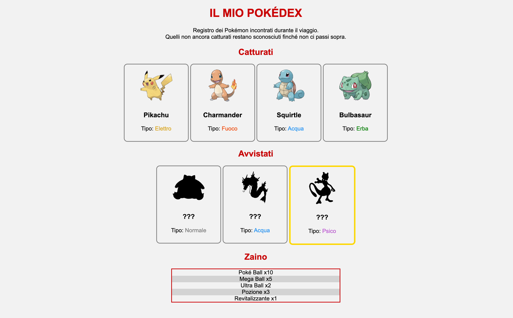

# Esercizio sui selettori: Pokédex

In questo esercizio completerete un piccolo Pokédex scrivendo **solo il CSS**.
L'obiettivo è imparare a usare i **selettori CSS**: per ogni specifica dovrete scegliere il selettore che colpisce *tutti e soli* gli elementi richiesti.

Il codice HTML e la cartella delle immagini sono all'interno di questa cartella.
**Non è possibile modificare il codice HTML, in nessuna delle due varianti.**

## Risultato atteso



## Contenuto della cartella

```
PokedExercise/
├── README.md
├── pokedex.html               (Parte 1)
├── pokedexSenzaClassi.html    (Parte 2)
├── img/                       (immagini dei Pokémon)
└── screenshot/
    └── risultato.png
```

## Parte 1: Pokédex con classi e id

Scrivere il file `pokedex.css` per completare il Pokédex.
Di seguito le specifiche per il file CSS:

1. Tutta la pagina deve usare il font Arial (con un font di riserva adeguato), su sfondo grigio chiarissimo (`#F2F2F2`), con tutti i contenuti centrati.
2. Il titolo principale e i titoli delle sezioni devono essere rossi (`#CC0000`), usando una sola regola.
3. Il titolo principale deve essere in maiuscolo.
4. Le carte dei Pokémon devono stare affiancate (usare `display: inline-block;`) e allineate in alto (usare `vertical-align: top;`), larghe 160px, con bordo grigio continuo di 2px, angoli arrotondati (`border-radius: 10px;`), testo centrato e 10px di spazio interno.
5. Le immagini dentro le carte devono essere larghe 100px.
6. Il nome di ogni tipo deve avere il suo colore: Elettro giallo scuro (`goldenrod`), Fuoco arancione (`orangered`), Acqua blu (`dodgerblue`), Erba verde (`green`), Normale grigio (`gray`), Psico viola (`mediumorchid`).
7. I Pokémon avvistati ma non catturati devono apparire come sagome nere (usare `filter: brightness(0);`), mentre quelli catturati restano normali.
8. Il Pokémon leggendario deve avere un bordo dorato (`gold`) di 4px.
9. Lo zaino deve essere largo il 25% della pagina, centrato, con un bordo rosso (`#CC0000`) continuo di 2px e senza i pallini della lista.
10. Gli oggetti dello zaino devono avere uno sfondo grigio chiaro su una riga sì e una no, a partire dalla seconda.
11. Passando il mouse su una carta dei Pokémon avvistati, la sagoma deve rivelare il Pokémon (`filter: none;`).

## Parte 2: Pokédex senza classi e id

Nella cartella è presente anche un secondo file HTML, `pokedexSenzaClassi.html`, con lo stesso contenuto ma senza classi e id, ad eccezione delle classi dei tipi.

Scrivere un nuovo file `pokedexSenzaClassi.css` che riproduca **esattamente lo stesso risultato** della Parte 1, rispettando le stesse 11 specifiche.
Per raggiungere gli elementi bisognerà usare selettori di elemento, selettori annidati (es. `section p`) e pseudo-classi (es. `:nth-child()`, `:nth-of-type()`).


**Buon lavoro!** :)

---

*Pokémon e i relativi personaggi e immagini sono © Nintendo / Creatures Inc. / GAME FREAK inc.
Le immagini contenute nella cartella `img` sono utilizzate esclusivamente a scopo didattico, senza fini di lucro.*
